# Comparación visual: juego vs. diseño (AngleCraft v1)

**Fecha:** 2026-10-21
**Cambio:** `openspec/changes/archive/2026-10-21-anglecraft-v1-visual-fidelity/` (archivado; especificaciones vigentes en `openspec/specs/`)
**Estado:** pendiente de aprobación de diseño

Este documento pone cada captura de referencia del juego (pruebas visuales de Playwright, 1920×1080, DPR 1, Chromium) junto a la pantalla equivalente de la maqueta o del Key Art. Cuando diseño apruebe, estas capturas quedan como referencia: cualquier cambio visual futuro hará fallar `npx playwright test --project=visual` hasta que se apruebe y se regeneren.

Las reglas del juego mandan sobre la maqueta: todas las diferencias intencionales están listadas abajo con la regla que las justifica.

## 1. Partida en curso

| Maqueta (pantalla 01) | Juego (`aiming`) |
|---|---|
| 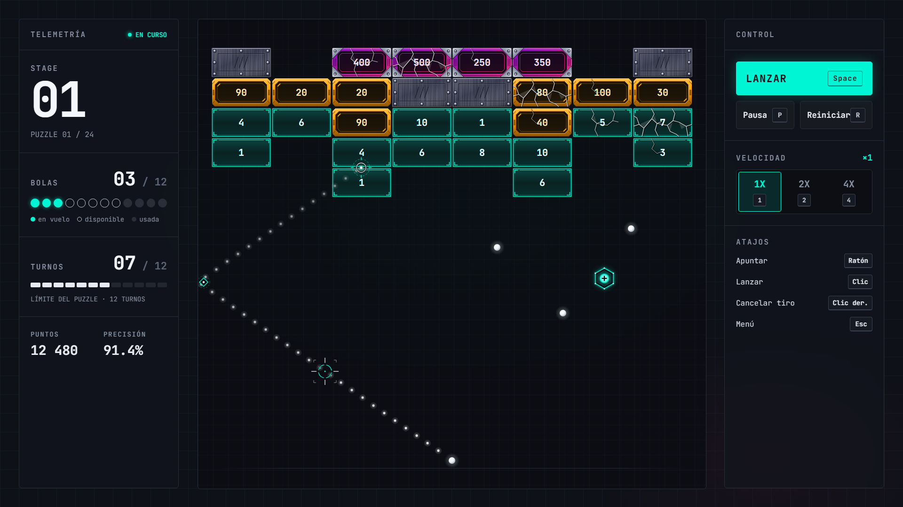 | 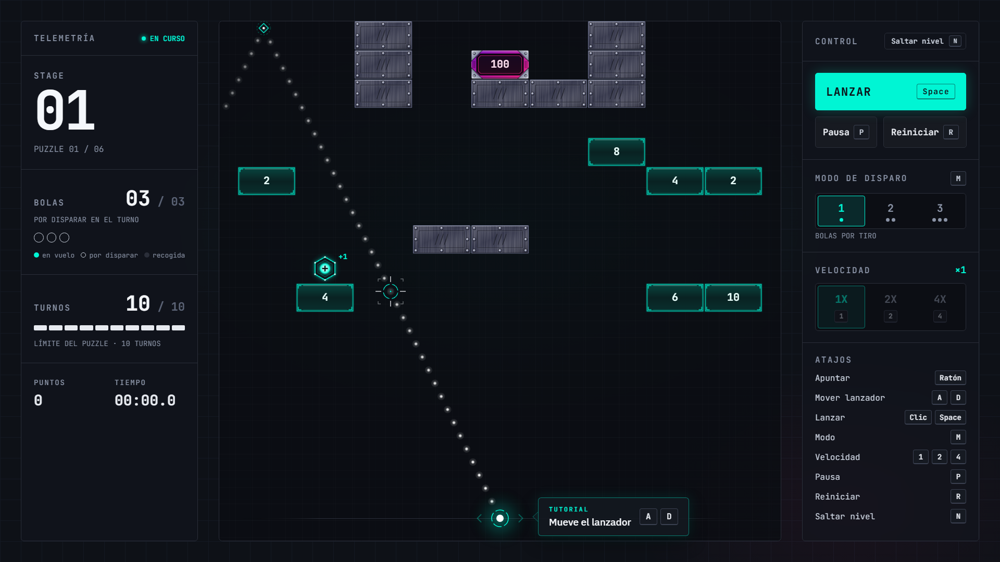 |

Coincide: fondo, tablero, sprites de bloques/bola/orbe, números de HP, trayectoria punteada con marcador, mira, lanzador, paneles TELEMETRÍA y CONTROL, keycaps, indicadores de bolas y barra de turnos.

## 2. Pausa

| Maqueta (pantalla 01 con pausa) | Juego (`paused`) |
|---|---|
|  | 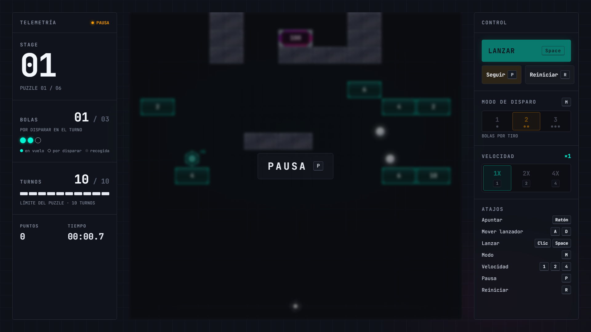 |

La maqueta muestra la pausa como un interruptor sobre la pantalla 01: desenfoque solo sobre el tablero, píldora "PAUSA [P]", estado ámbar en TELEMETRÍA y botón "Seguir".

## 3. Victoria

| Maqueta (pantalla 02) | Juego (`victory`, 2 estrellas) |
|---|---|
| 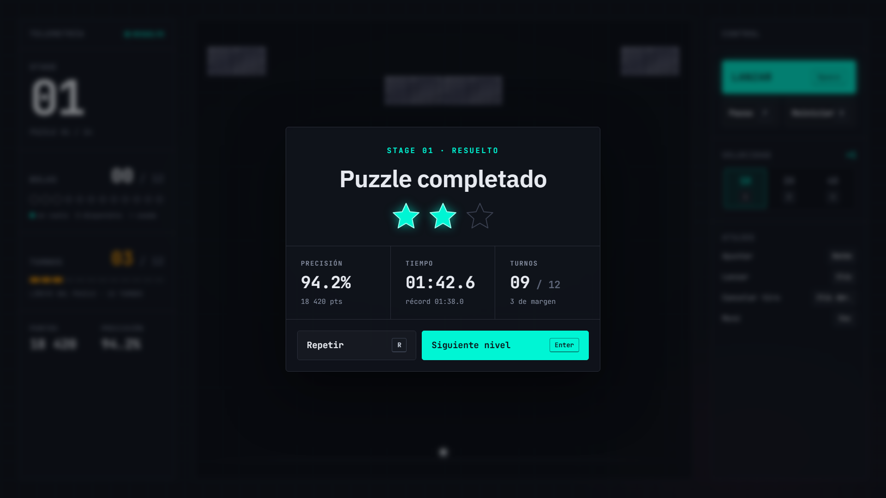 | 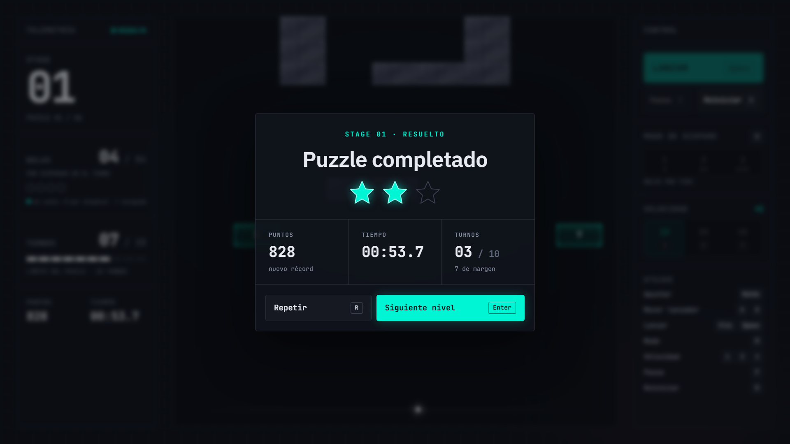 |

## 4. Derrota

| Maqueta (pantalla 03) | Juego (`defeat`) |
|---|---|
| 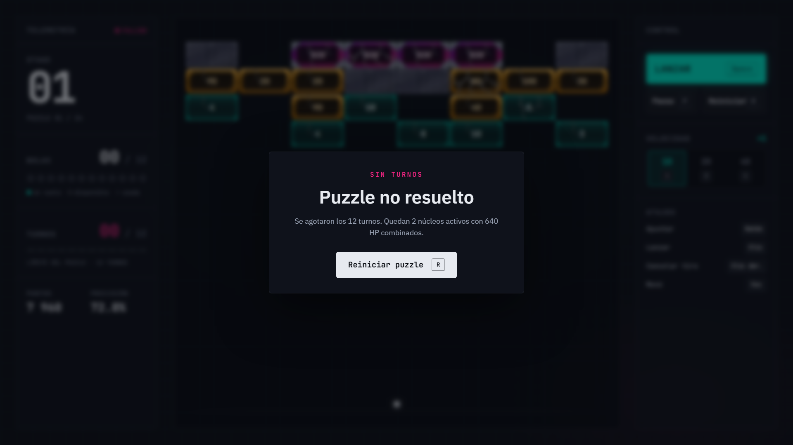 | 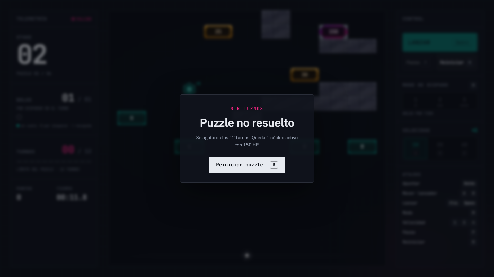 |

## 5. Pantalla de inicio

| Key Art | Juego (`title`) |
|---|---|
| 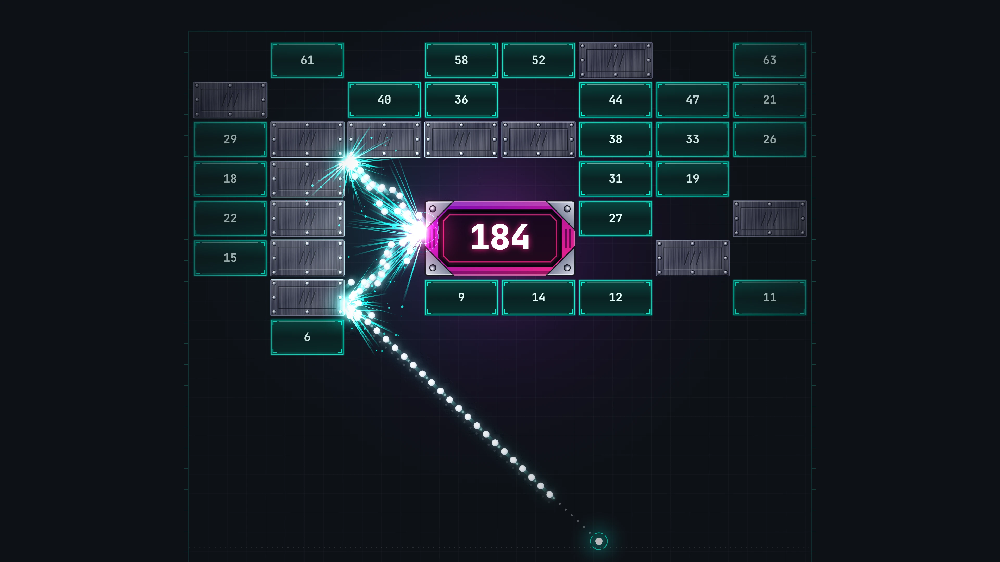 | 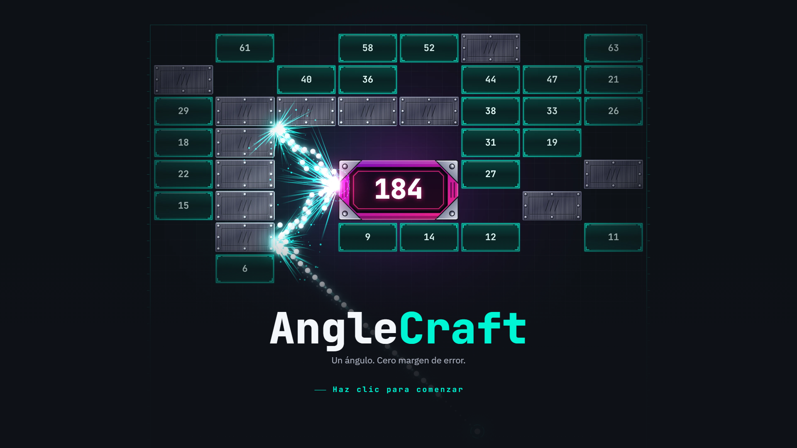 |

El Key Art se exporta sin su texto (`scripts/export-key-art.mjs`) y el juego dibuja encima el nombre, el lema y la carga.

## 6. Diferencias intencionales

| Diferencia | Maqueta / Key Art | Juego | Regla |
|---|---|---|---|
| Métrica PRECISIÓN | Panel TELEMETRÍA y modal de victoria | Se reemplaza por TIEMPO (panel) y PUNTOS (modal) | A6: precisión eliminada de v1 |
| Atajo "Menú — Esc" | Listado en ATAJOS | No aparece; se listan Velocidad, Pausa y Reiniciar | C2: sin menú `Esc` en v1 |
| Atajo "Cancelar tiro — Clic der." | Listado en ATAJOS | No aparece | C3: sin cancelar con clic derecho en v1 |
| Tablero | 8 columnas de bloques 128×64 | 9×12 celdas de 112×56 (sprites escalados) | B1 |
| `PUZZLE 01 / 24` | 24 puzzles | `PUZZLE 01 / 06` | D3_count: 6 niveles en v1 |
| Récord en TIEMPO del modal | "récord 01:38.0" | Sin récord de tiempo; el récord va en PUNTOS ("récord N pts" o "nuevo récord") | A5: los récords guardan estrellas, puntos y tiros |
| Rangos de HP en los números | 1–10 / 20–100 / 200–500 | 1–15 / 20–80 / 100–500 | Skills del proyecto (pendiente 2.1 de diseño) |
| Posición del nombre en el inicio | Abajo a la izquierda ("STAGE 27", "×72 BOLAS", "136.5°") | Centrado en x = 960, sin datos de etapa | HU-09: título centrado |
| Lema | "Un ángulo. Setenta y dos bolas. Cero margen de error." | "Un ángulo. Cero margen de error." | A10_v1_cap: tope de 50 bolas (OI-1, a confirmar) |
| Etiqueta del orbe | Solo el símbolo `+` | `+V` arriba a la derecha del orbe | A11: mostrar el valor del orbe |
| Daño del bloque | Grietas | Grietas (sin variación de color por HP) | Pendiente 2.5 de diseño |
| Destello, partículas, chispas | No especificados | Procedurales con los colores del tema | Pendientes 2.3 y 2.4 de diseño |

## 7. Pendientes de diseño que afectan lo visual

- **OI-1:** confirmar el lema del título (72 bolas vs. tope de 50).
- **OI-2:** colores por nivel de HP para cada tipo de bloque (pendiente 2.5).
- **OI-3:** reexportar bricks y grietas a 112×56 (pendiente 2.2).
- **OI-4:** sprite del lanzador (pendiente 2.6); hoy se dibuja con el estilo del Key Art.

## 8. Lanzador móvil y modo de disparo (HU-10, HU-11)

Fuente: lienzo de Claude Design [AngleCraft — Tutorial y modo de disparo](https://claude.ai/artifact/BU6xTioBfQoAEgJuBCHFtk) (mesas 01 a 03; privado hasta compartirlo).

| Lienzo | Juego |
|---|---|
| 01 · Nivel 1, tutorial A / D |  |
| 02 · Nivel 2, tutorial del modo | 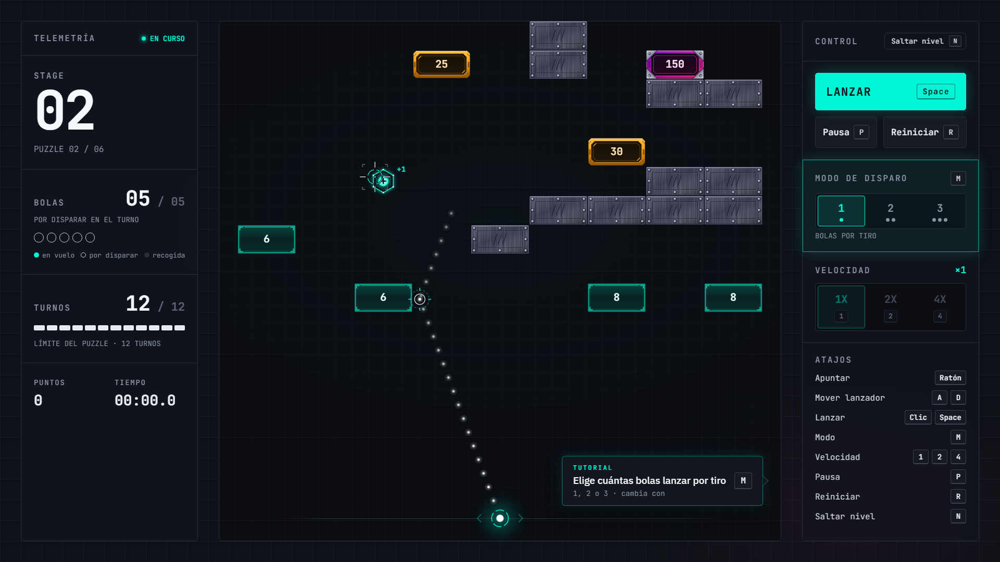 |
| 03 · BOLAS del turno, entre grupos | 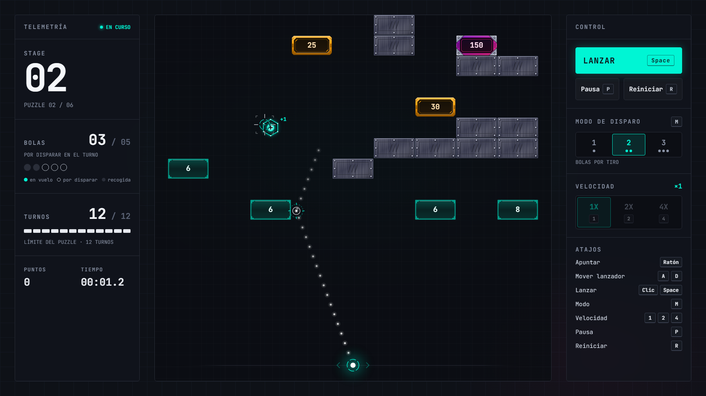 |

Diferencias intencionales:

| Diferencia | Lienzo | Juego | Motivo |
|---|---|---|---|
| Indicación A / D cerca del borde derecho | Siempre a la derecha del lanzador | Pasa a la izquierda si el lanzador está a más de x = 640 | Que no se salga del tablero |
| Opción de modo en modo de pruebas `'turn'` | No existe | Ninguna opción activa | Solo pruebas de v1; inalcanzable jugando |
| Lanzador entre grupos | Junto a donde cayó la primera bola | Donde lo dejó el jugador | HU-14: las bolas que caen ya no mueven el lanzador |

Umbral de las capturas: `threshold` 0,1 y `maxDiffPixels` 150. El umbral anterior (0,2 % de los píxeles) dejaba pasar un recuadro oscuro sobre fondo oscuro, como la indicación del tutorial.

## 9. Cómo actualizar las referencias

1. Hacer el cambio visual y revisarlo con diseño.
2. Regenerar: `npx playwright test --project=visual --update-snapshots`.
3. Verificar estabilidad: `npx playwright test --project=visual --repeat-each=5`.
4. Actualizar las capturas de este documento si cambia la maqueta (`docs/visual-fidelity/mockup-0N.png`).

Las referencias tienen sufijo de plataforma (`-win32`): se generaron en Windows. Para correrlas en otro sistema operativo hay que generar las suyas en ese sistema.
